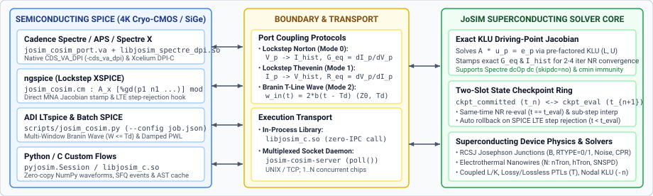

# Superconducting / Semiconducting SPICE Co-Simulation & In-Memory Python/C API

JoSIM (`v2.8`) includes a modular **superconducting/semiconducting co-simulation framework** and an **in-memory C/Python API (`libjosim_c` / `pyjosim`)** for simulating hybrid cryogenic circuits that combine superconducting subsystems (**JoSIM**: RSFQ, AQFP, dc-SQUIDs, SNSPDs, and electrothermal `nTron`/`hTron` nanowires) with semiconducting Cryo-CMOS / SiGe / III-V circuits in **`ngspice`**, **ADI `LTspice`**, and **Cadence Spectre / APS / Spectre X**.

---

## 1. Co-Simulation Architecture & Block Diagram

<p align="center">
  
</p>

| Architectural Component | Target Simulators / Use Cases | Key Files |
| :--- | :--- | :--- |
| **In-Memory C/Python Core Stepping, Exact KLU Norton Jacobian & Auto-Rollback Engine (`libjosim_c` / `pyjosim`)** | Python optimization loops, custom solvers, in-process lockstep or windowed co-simulation | [`include/JoSIM/josim_c_api.h`](../include/JoSIM/josim_c_api.h), [`src/josim_c_api.cpp`](../src/josim_c_api.cpp), [`scripts/pyjosim.py`](../scripts/pyjosim.py) |
| **Multiplexed IPC Socket Daemon (`josim-cosim-server`) & `ngspice` XSPICE Code Model (`josim_cosim.cm`)** | Out-of-process UNIX (`AF_UNIX`) & TCP (`AF_INET`) multi-instance co-simulation; native `ngspice` MNA lockstep coupling | [`include/JoSIM/josim_cosim_ipc.h`](../include/JoSIM/josim_cosim_ipc.h), [`src/josim_cosim_server.cpp`](../src/josim_cosim_server.cpp), [`cosim/ngspice/josim_xspice.c`](../cosim/ngspice/josim_xspice.c) |
| **Cadence Spectre `CDS_VA_DPI` / DPI-C Adapter (`libjosim_spectre_dpi.so` + `josim_cosim_port.va`)** | Native Cadence Spectre (`-cds_va_dpi`) and Xcelium AMS (`DPI-C`) lockstep co-simulation with `dcOp dc` (`skipdc=no`) | [`include/JoSIM/josim_spectre_dpi.h`](../include/JoSIM/josim_spectre_dpi.h), [`cosim/spectre/josim_cosim_dpi.c`](../cosim/spectre/josim_cosim_dpi.c), [`cosim/spectre/josim_cosim_port.va`](../cosim/spectre/josim_cosim_port.va), [`cosim/spectre/run_spectre_cosim.sh`](../cosim/spectre/run_spectre_cosim.sh) |
| **Multi-Window Branin Wave, Iterative PWL (`LTspice`), Spectre Runner & Unified CLI (`scripts/josim_cosim.py`)** | Multi-window causal Branin wave relaxation, `LTspice.exe -b` `.raw` coupling, remote SSH Spectre runner, and JSON CLI | [`scripts/josim_cosim.py`](../scripts/josim_cosim.py) |

### Key Mathematical & Numerical Features
1. **Exact KLU Driving-Point Norton/Thevenin Jacobian:**
   - For each port $p$ in `JOSIM_PORT_VOLTAGE_IN_CURRENT_OUT` mode, JoSIM solves $A \mathbf{u}_p = \mathbf{e}_{b_p}$ using its pre-factored SuiteSparse KLU factors to obtain the exact driving-point Norton conductance $G_{\text{eq},p} = \partial I_p / \partial V_p$ (or Thevenin resistance $R_{\text{eq},p} = \partial V_p / \partial I_p$ in `JOSIM_PORT_CURRENT_IN_VOLTAGE_OUT` mode).
   - Stamping both $I_p(V_p)$ and $G_{\text{eq},p}$ into SPICE's MNA matrix yields quadratic Newton–Raphson convergence (2–4 iterations per step).
2. **Two-Slot Checkpoint Ring & Automatic LTE Rollback:**
   - JoSIM maintains `ckpt_committed` ($t_n$) and `ckpt_eval` ($t_{n+1}$) snapshots (`Simulation::cosim_save_ckpt` / `Simulation::cosim_restore_ckpt`) covering the full MNA vector $\mathbf{x}$, device history registers, Josephson junction thermal/switching states, transmission-line circular buffers, and `Nanowire` hotspot states.
   - `josim_cosim_step_to(sess, t_target, ...)` automatically detects:
     - **Same-time Newton–Raphson re-evaluation** ($t_{\text{target}} == t_{\text{eval}}$): restores `ckpt_committed` and re-solves with updated port inputs.
     - **Forward step advancement** ($t_{\text{target}} > t_{\text{eval}}$): auto-commits `ckpt_eval` into `ckpt_committed` and advances to $t_{\text{target}}$ (with sub-grid linear interpolation when $t_{\text{target}}$ lies between JoSIM grid steps).
     - **SPICE LTE step rejection / rollback** ($t_{\text{target}} < t_{\text{eval}}$): restores `ckpt_committed` ($t_n$), prunes uncommitted SFQ events/traces, and steps to the new smaller $t_{\text{target}}$ with zero state drift.
3. **Windowed Branin Wave Coupling (`JOSIM_PORT_WAVE_BRANIN`):**
   - When superconducting and semiconducting chips are connected by a transmission line of impedance $Z_0$ and delay $\tau_d$ (e.g. $50\,\Omega$ cryogenic coax or flex cable), both simulators are strictly decoupled over any window $W \le \tau_d$ via Branin's characteristic waves ($w_{\text{in}} = 2 b_p(t - \tau_d) = V_p + Z_0 I_p$, $b_{\text{out}} = V_p - Z_0 I_p$).

---

## 2. In-Memory Python (`pyjosim`) & C API (`libjosim_c`)

### 2.1 One-Shot & Persistent Session Simulation in Python

```python
import sys
sys.path.insert(0, "scripts")
import pyjosim

# 1. One-shot simulation from file or netlist string (zero-copy NumPy views)
res = pyjosim.simulate_file("test/ex_jtl_basic.cir", params={"IBIAS": 280e-6})
t = res.time                 # 1D float64 NumPy view into C++ std::vector<double>
p_b01 = res["P(B01)"]        # 1D float64 NumPy view
events = res.events          # Structured NumPy array of 2*pi SFQ switching events
params = res.params          # Dict of all evaluated .param values
meas = res.meas              # Dict of all evaluated .meas values

# 2. Persistent session with pre-parsed AST re-use (ideal for optimization loops)
with pyjosim.JoSIMSession() as sim:
    sim.load_file("test/ex_jtl_basic.cir")
    for scale in [0.85, 1.0, 1.15]:
        r = sim.run(params={"AREA_SCALE": scale})
        print(scale, len(r.events))
```

### 2.2 Lockstep & Windowed Co-Simulation in Python (`pyjosim.Session`)

```python
import pyjosim

with pyjosim.Session() as sess:
    sess.load_string(josim_netlist)
    # Register boundary port: mode = PORT_VOLTAGE_IN_CURRENT_OUT (0), PORT_CURRENT_IN_VOLTAGE_OUT (1), or PORT_WAVE_BRANIN (2)
    port_id = sess.cosim_add_port("nport", "0", mode=pyjosim.PORT_VOLTAGE_IN_CURRENT_OUT)
    dt, tstop = sess.cosim_init(analysis_type=1)  # 1 = Phase mode, 0 = Voltage mode

    # Lockstep stepping loop (supports same-time NR iterations and LTE rollbacks)
    out, geq = sess.cosim_step_to(t_target=1.0e-12, inputs=[0.25e-3])
    sess.cosim_commit()          # Optional explicit commit
    sess.cosim_rollback()        # Optional explicit rollback to last committed state

    # Finalize to materialize .print traces, SFQ events, and .meas results
    res = sess.cosim_finalize()
```

### 2.3 C API Reference (`include/JoSIM/josim_c_api.h`)

| C Function | Description |
| :--- | :--- |
| `josim_session_create()` / `josim_session_destroy(s)` | Allocate or free an isolated `josim_session_t` instance. |
| `josim_load_netlist_file(s, path)` / `josim_load_netlist_string(s, text, base_dir)` | Parse and cache the netlist AST in memory. |
| `josim_set_parameter(s, name, val)` | Override or define a `.param` value before running. |
| `josim_run(s)` | Execute a complete transient simulation and post-processing pass in memory. |
| `josim_num_traces(s)` / `josim_trace_name(s, i)` / `josim_trace_data(s, i)` | Zero-copy access to simulated waveform columns (`double*`). |
| `josim_num_events(s)` / `josim_events_data(s)` | Zero-copy access to extracted $2\pi$ SFQ switching events (`josim_sfq_event_t*`). |
| `josim_num_measurements(s)` / `josim_measurement_name(s, i)` / `josim_measurement_value(s, i)` | Read evaluated `.meas` results. |
| `josim_cosim_add_port(s, pos, neg, mode, z0)` | Register a co-simulation boundary port (`mode`: `0` = Norton $V\to I$, `1` = Thevenin $I\to V$, `2` = Branin wave). |
| `josim_cosim_init(s, analysis_type, nodal)` | Build the MNA matrix, factor KLU, and initialize the two-slot rollback checkpoint ring. |
| `josim_cosim_step_to(s, t_target, inputs, n_in, outputs, geq, n_out)` | Advance, re-evaluate (NR), or auto-rollback to `t_target`, returning port outputs and exact KLU $G_{\text{eq}}$ / $R_{\text{eq}}$. |
| `josim_cosim_commit(s)` / `josim_cosim_rollback(s)` | Explicitly commit `ckpt_eval` or roll back to `ckpt_committed`. |
| `josim_cosim_run_window(s, t_start, t_end, sample_dt, n_samples, w_in, b_out)` | Advance a full Branin wave window $[t_{\text{start}}, t_{\text{end}}]$ in one call. |
| `josim_cosim_finalize(s)` | Populate `.print` traces, SFQ events, and `.meas` results after co-simulation completes. |

---

## 3. Multiplexed IPC Daemon (`josim-cosim-server`) & `ngspice` XSPICE Code Model (`josim_cosim.cm`)

### 3.1 `josim-cosim-server` CLI Reference

`josim-cosim-server` is a standalone POSIX socket daemon that hosts one or more concurrent `josim_session_t` instances in a `poll()`-multiplexed event loop:

```bash
# Listen on a UNIX domain socket for 2 concurrent SPICE/Spectre subcircuit instances
josim-cosim-server --unix /tmp/josim_cosim.sock --max-clients 2 --quiet

# Listen on a TCP socket (port 0 auto-selects an ephemeral port and prints JOSIM_COSIM_PORT=<port>)
josim-cosim-server --port 0 --once --output cosim_traces.csv
```

| Option | Description |
| :--- | :--- |
| `--unix <path>` | Listen on a UNIX domain socket (`AF_UNIX`) at `<path>`. |
| `--port <port>` | Listen on a TCP socket (`AF_INET` `127.0.0.1:<port>`, `TCP_NODELAY`); pass `0` for an OS-assigned port. |
| `--netlist <file.cir>` | Optional default netlist pre-loaded for connecting clients. |
| `--output <file.csv>` | Write finalized JoSIM `.print` waveforms to `<file.csv>` and SFQ events to `<file.csv>.events.csv` upon `FINALIZE`. |
| `--once` | Exit automatically after the first client disconnects. |
| `--max-clients <N>` / `--expected-clients <N>` | Exit automatically after `<N>` concurrent/sequential clients have connected and disconnected. |
| `--quiet` | Suppress startup banner messages (prints only `JOSIM_COSIM_PORT=<port>` when `--port` is used). |

### 3.2 Native `ngspice` XSPICE Code Model (`josim_cosim.cm`)

When built on Linux/WSL (`cmake --build build`), CMake compiles `josim_cosim.cm` from [`cosim/ngspice/josim_xspice.c`](../cosim/ngspice/josim_xspice.c). It supports both **in-process `dlopen("libjosim_c.so")`** (`server_addr=""`) and **IPC socket mode** (`server_addr="unix:/tmp/josim.sock"` or `"tcp:127.0.0.1:54321"`), as well as arbitrary multi-port (`[%gd(p1 n1) %gd(p2 n2) ...]`) voltage-controlled current ports:

```spice
* 1-Port JoSIM SFQ/nTron subcircuit coupled to ngspice nodes (nd, 0)
A_ntron [%gd(nd 0)] josim_ntron_mod
.model josim_ntron_mod josim_cosim(
+ netlist="cosim/spectre/examples/ntron_driver.cir"
+ pos_nodes=["nd"]
+ neg_nodes=["0"]
+ port_modes=[0]
+ phase_mode=1
+ server_addr=""
+ out_csv="ntron_traces.csv"
+ events="ntron_events.csv"
+ debug_log=""
+ )

* 2-Port JoSIM subcircuit (Port 1 = sfq_set, Port 2 = sfq_ro)
A_dff [%gd(sfq_set 0) %gd(sfq_ro 0)] josim_dff_mod
.model josim_dff_mod josim_cosim(
+ netlist="cosim/spectre/examples/sfq_dff.cir"
+ pos_nodes=["n_set" "n_ro"]
+ neg_nodes=["0" "0"]
+ port_modes=[0 0]
+ )

* Load the JoSIM XSPICE code model and run transient analysis in ngspice
.control
pre_codemodel /tmp/josim-build/josim_cosim.cm
set wr_singlescale
tran 0.2p 60p
.endc
```

> **Note on `ngspice` `.control` Path Lowercasing:** `ngspice`'s deck reader lowercases unquoted lines inside `.control ... .endc` blocks and does not strip double quotes around path arguments to `pre_codemodel`, `pre_osdi`, or `wrdata`. Always place or symlink `josim_cosim.cm`, `.osdi` files, and `.dat` outputs under an **all-lowercase directory path** (e.g., `/tmp/josim-build/josim_cosim.cm` or `~/local/src/josim/build/josim_cosim.cm`) when loading them from `.control`. Inside `.model ... josim_cosim(...)`, double-quoted strings (`netlist="..."`, `out_csv="..."`, `events="..."`, `debug_log="..."`) preserve case.

---

## 4. Cadence Spectre `CDS_VA_DPI` / DPI-C Adapter (`cosim/spectre/`)

### 4.1 Using `libjosim_spectre_dpi.so` + `josim_cosim_port.va` in Cadence Spectre

[`cosim/spectre/josim_cosim_port.va`](../cosim/spectre/josim_cosim_port.va) provides seven ready-to-use Verilog-A modules that import [`libjosim_spectre_dpi.so`](../cosim/spectre/josim_cosim_dpi.c) via Cadence Spectre's native `CDS_VA_DPI` interface (or standard `DPI-C` under Xcelium AMS when `` `ifdef INCA `` is defined):

- **1-Port Modules:** `josim_cosim_port_norton (p, n)` ($V \to I$ Norton companion) and `josim_cosim_port_thevenin (p, n)` ($I \to V$ Thevenin companion). Both cache `(handle, $abstime, V/I)` in `libjosim_spectre_dpi.so` so `josim_dpi_eval_ihist` and `josim_dpi_eval_geq` share a single JoSIM evaluation per Spectre call.
- **Multi-Port Modules ($N = 2, 3, 4, 6, 8$):**
  - `josim_cosim_port_2p (p1, n1, p2, n2)`
  - `josim_cosim_port_3p (p1, n1, p2, n2, p3, n3)`
  - `josim_cosim_port_4p (p1, n1, p2, n2, p3, n3, p4, n4)`
  - `josim_cosim_port_6p (p1, n1, ..., p6, n6)`
  - `josim_cosim_port_8p (p1, n1, ..., p8, n8)`
- **JoSIM-Side Waveform & Event Observability (`out_csv` & `events`):** Every module accepts optional parameters `out_csv="<path.csv>"` and `events="<events.csv>"` (forwarded via `josim_dpi_set_output(h, out_csv, events)` / `JOSIM_IPC_CMD_SET_OUTPUT` to `josim-cosim-server` or in-process `libjosim_c.so`), writing all `.print` traces and $2\pi$ SFQ switching events of the internal JoSIM subcircuit upon `@(final_step)`.

```spectre
// Example Cadence Spectre (.scs) Hybrid Cryo-CMOS + JoSIM Co-Simulation Deck
simulator lang=spectre
global 0

ahdl_include "libjosim_spectre_dpi.so" -cds_va_dpi
ahdl_include "josim_cosim_port.va"

opts options temp=4.2 tnom=4.2 gmin=1e-12

// Partition 1: 1-Port JoSIM SFQ Transmitter
X_sfq_tx (n2 0) josim_cosim_port_norton netlist="sfq_tx.cir" port_nodes="n2" port_modes="0"

// Partition 2: 3-Port JoSIM SFQ Splitter Macro with Internal Waveform & Event Output
X_split (min_a 0 mout_q0 0 mout_q1 0) josim_cosim_port_3p \
    netlist="split_core.cir" port_nodes="min_a,mout_q0,mout_q1" port_modes="0,0,0" \
    out_csv="split_macro_traces.csv" events="split_macro_events.csv"

// Standard Spectre DC Operating Point (skipdc=no) + Transient Analysis
dcOp dc
tran1 tran stop=60p step=0.2p maxstep=0.2p errpreset=conservative
```

### 4.2 Shell & Python Runners for Cadence Spectre

- **Shell Wrapper ([`cosim/spectre/run_spectre_cosim.sh`](../cosim/spectre/run_spectre_cosim.sh)):**
  ```bash
  cosim/spectre/run_spectre_cosim.sh \
    --netlist sfq_core.cir \
    --scs cryo_cmos_sfq.scs \
    --build-dir /tmp/josim-build
  ```
- **Python Local / Remote SSH Runner (`SpectreCosimRunner` in [`scripts/josim_cosim.py`](../scripts/josim_cosim.py)):**
  ```python
  from josim_cosim import SpectreCosimRunner

  runner = SpectreCosimRunner(ssh_host="asic2")  # or ssh_host=None for local Spectre
  res = runner.run(
      scs_content=scs_deck_str,
      josim_files={"sfq_tx.cir": sfq_tx_cir, "ntron_rx_2p.cir": ntron_rx_2p_cir},
      saved_signals=["n2", "n3", "nd", "vout"],
  )
  print(res.ok, res.dc_ok, res.accepted_steps, res.tran_cpu_s)
  ```

### 4.3 Fair Like-for-Like Performance & Accuracy vs. Monolithic Verilog-A (`seeqc_jj3.va`)

All benchmarks below use identical junction parameters (`ic=100u, cap=50f, rqp=4.0`), return the far-end node(s) (`jtl_N` or `mout_q0, mout_q1`) to SPICE/Spectre via 2-port/3-port co-simulation modules, run until all SFQ pulses reach the far end, and compare timing accuracy against monolithic JoSIM at `0.025 ps`:

| Benchmark / Capability | Monolithic Verilog-A (`seeqc_jj3.va` / `.osdi`) | Partitioned JoSIM Co-Simulation (`libjosim_spectre_dpi.so` / `josim_cosim.cm`) |
| :--- | :--- | :--- |
| **`ngspice-45.2` + `openvaf`: 16–160 JJs + 32 MOSFETs (`0.1 ps` step)** | $0.119\text{–}2.289\text{ s}$ wall ($0.014\text{–}0.066\text{ ps}$ arrival error) | **$4.63\times\text{–}11.49\times$ faster** ($0.026\text{–}0.199\text{ s}$ wall, **$0.001\text{–}0.003\text{ ps}$ error**) |
| **`ngspice-45.2` + `openvaf`: 1000 JJs + 32 MOSFETs ($1.8\text{ ns}$)** | $63.0\text{ s}$ (`0.1p`, $0.37\text{ ps}$ err) / $251.0\text{ s}$ (`0.025p`, $0.029\text{ ps}$ err) | **$6.69\text{ s}$ wall (`0.1p`) — $9.4\times\text{–}37.5\times$ faster**, **$0.0003\text{ ps}$ arrival error** |
| **`ngspice-45.2` + `openvaf`: 30-JJ `macro-SPLIT` PTL Macro ($1.05\text{ ns}$, 80 events)** | $43.0\text{ s}$ (`0.05p`, $0.0006\text{ ps}$ err) / $66.0\text{ s}$ (`0.025p`, $0.0003\text{ ps}$ err) | **$21.93\text{ s}$ wall (`0.1p`, $0.0021\text{ ps}$ err, 80/80 events)** / **$33.09\text{ s}$ (`0.025p`, $0.0002\text{ ps}$ err)** |
| **Cadence Spectre 25.1 (`asic2`): 100 JJs + 32 MOSFETs ($260\text{ ps}$)** | `0.1p`: $0.336\text{ s}$ `tran` ($1.90\text{ s}$ wall, $0.0595\text{ ps}$ err)<br>`0.025p`: $1.15\text{ s}$ `tran` ($2.95\text{ s}$ wall, $0.0005\text{ ps}$ err) | `0.1p`: $0.224\text{ s}$ `tran` ($2.38\text{ s}$ wall, $0.13\text{ s}$ srv CPU, $7.5\text{ MB}$ RSS, **$0.0113\text{ ps}$ err**)<br>`0.5p`: $0.305\text{ s}$ `tran` ($2.50\text{ s}$ wall, $0.23\text{ s}$ srv CPU, **$0.0364\text{ ps}$ err**) |
| **Cadence Spectre 25.1 (`asic2`): 1000 JJs + 32 MOSFETs ($1.8\text{ ns}$)** | `0.1p`: $21.1\text{ s}$ `tran` ($23.1\text{ s}$ wall, $0.630\text{ ps}$ err)<br>`0.025p`: $72.2\text{ s}$ `tran` ($74.5\text{ s}$ wall, $0.0024\text{ ps}$ err) | `0.1p`: **$8.48\text{ s}$ `tran` / $10.52\text{ s}$ wall ($2.2\times\text{–}7.1\times$ faster)**, $7.60\text{ s}$ srv CPU, **$16.1\text{ MB}$ RSS**, **$0.0109\text{ ps}$ err** |
| **Cadence Spectre 25.1 (`asic2`): 30-JJ `macro-SPLIT` PTL Macro ($1.05\text{ ns}$, 80 events)** | `0.05p`: $3.4\text{ s}$ `tran` ($0.015\text{ ps}$ err, 80/80)<br>`0.025p`: $6.4\text{ s}$ `tran` ($0.0061\text{ ps}$ err, 80/80) | `0.1p`: **$2.67\text{ s}$ wall ($0.49\text{ s}$ srv CPU, $7.0\text{ MB}$ RSS, $0.0025\text{ ps}$ err, 80/80)**<br>`0.025p`: $7.15\text{ s}$ wall ($1.12\text{ s}$ srv CPU, **$0.0001\text{ ps}$ err, 80/80**) |
| **Spectre `dcOp dc` Convergence (`skipdc=no`)** | **Fails** (`skipdc=yes` required due to floating phase capacitor `ph`) | **Converges in 2 NR iterations** via JoSIM's $t=0$ Norton companion |
| **Spectre `cmin` Option Immunity** | Setting `cmin=0.1f` adds $0.1\text{ fF}$ in parallel with `PHI0_2PI = 0.3291 fF`, **corrupting $\Phi_0$ by $+30.4\%$** ($20.8\text{ ps}$ late over $184\text{ ps}$) | **100% immune** (Josephson phase is internal to JoSIM) |
| **Device Physics** | Linear `rtype=0` resistor only; no `nTron`/`hTron`, no thermal noise | Full `rtype=1` nonlinear subgap/gap $I\text{–}V$, thermal noise, lossy PTLs, and electrothermal `nTron`/`hTron` |

---

## 5. Multi-Window Branin Wave, Iterative PWL (`LTspice`) & Unified CLI (`scripts/josim_cosim.py`)

### 5.1 Multi-Window Causal Branin Wave Relaxation (`LTspice` & `ngspice`)

When coupling `LTspice.exe -b` or `ngspice -b` to JoSIM across one or more transmission lines of impedance $Z_0$ and delay $\tau_d$, [`run_ltspice_branin_cosim`](../scripts/josim_cosim.py) and [`run_ngspice_branin_cosim`](../scripts/josim_cosim.py) partition $[0, T_{\text{stop}}]$ into $N_w = \lceil T_{\text{stop}} / W \rceil$ causal windows ($W \le \tau_d$) and exchange exact delayed reflected waves $w_{\text{in}}(t) = 2 b_{\text{out}}(t - \tau_d)$:

```python
from josim_cosim import BraninPortLink, run_ltspice_branin_cosim

links = [
    BraninPortLink("n_rx_port", "0", spice_port_trace="v(tx_port)", spice_pwl_placeholder="{PWL_WIN_TX}", z0=50.0, td=15e-12),
    BraninPortLink("n_tx_port", "0", spice_port_trace="v(rx_port)", spice_pwl_placeholder="{PWL_WIN_RX}", z0=50.0, td=15e-12),
]
res = run_ltspice_branin_cosim(
    ltspice_template_str,
    josim_netlist_str,
    links=links,
    t_stop=60e-12,
    window_size=10e-12,         # W = 10 ps <= Td = 15 ps -> 6 causal windows
    endpoint="inproc",          # or "unix:/tmp/josim.sock" / "tcp:127.0.0.1:54321"
    spice_vectors=["v(tx_port)", "v(rx_out)"],
    josim_trace_names=["P(B_RX1)", "P(B_RX2)"],
)
```

### 5.2 Iterative Robin/Thevenin PWL Relaxation for `LTspice` (`run_ltspice_pwl_cosim`)

For direct wire/pad connections in `LTspice.exe` without a transmission line delay, `run_ltspice_pwl_cosim` performs damped Robin/Thevenin waveform relaxation between `LTspice.exe -b` and JoSIM, converging in 3–4 iterations to $< 60\,\mu\text{V}$ ($0.3\%$ cross-simulator NRMSE vs. lockstep `ngspice` XSPICE).

### 5.3 Unified JSON CLI (`python3 scripts/josim_cosim.py --config <spec.json>`)

```bash
python3 scripts/josim_cosim.py --config cosim_job.json --output-json report.json
```

Supported `"mode"` values in `cosim_job.json`:
- `"ngspice_xspice"`: Runs `ngspice` with `josim_cosim.cm` (optionally launching a managed `josim-cosim-server` when `"use_server": true`).
- `"ltspice_branin"` / `"ngspice_branin"`: Runs multi-window causal Branin wave co-simulation.
- `"ltspice_pwl"`: Runs iterative Robin/Thevenin PWL waveform relaxation in `LTspice.exe`.
- `"spectre"`: Runs local or remote SSH (`"ssh_host": "asic2"`) Cadence Spectre co-simulation.

---

## Complete Runnable Co-Simulation Example Decks

Ready-to-run co-simulation example decks for **Cadence Spectre**, **`ngspice`**, and **ADI `LTspice`** are provided in the repository under:

- `cosim/ngspice/examples/` (`ngspice -b` + `josim_cosim.cm` XSPICE code model)
- `cosim/spectre/examples/` (Cadence `spectre` + `libjosim_spectre_dpi.so` + `josim_cosim_port.va`)
- `cosim/ltspice/examples/` (`LTspice.exe -b` + `scripts/josim_cosim.py` Branin wave and PWL relaxation coordinators)

### Overview of Included Example Decks

| Simulator | Example Deck / Config | Coupled JoSIM Subcircuit(s) | Coupling Protocol | Circuit Description & Expected Behavior |
| :--- | :--- | :--- | :--- | :--- |
| **`ngspice`** | `cosim/ngspice/examples/cmos_to_sfq_dff.sp` | `sfq_dff.cir` (2-port) | Lockstep XSPICE (`josim_cosim.cm`, mode `0`) | 4K Cryo-CMOS DATA ($18\text{–}22\text{ ps}$) and CLOCK ($44\text{–}48\text{ ps}$) drivers set `B_set` ($\Delta\phi \approx 2\pi$) and trigger destructive readout across `B_ro`. |
| **`ngspice`** | `cosim/ngspice/examples/ntron_to_cmos_lna.sp` | `ntron_driver.cir` (1-port) | Lockstep XSPICE (`josim_cosim.cm`, mode `0`) | 2-JJ SFQ pulse triggers electrothermal `N1` (`nanowire`), generating an $8.94\text{ mV}$ channel pulse amplified to $83.4\text{ mV}_{\text{pp}}$ at `v(vout)` by a 2-stage 4K Cryo-CMOS LNA. |
| **`ngspice`** | `cosim/ngspice/examples/multi_instance_transceiver.sp` | `sfq_tx.cir` (1-port) + `ntron_rx_2p.cir` (2-port) | 2 Concurrent Lockstep XSPICE Instances | Partition 1 transmits an SFQ pulse through an inter-chip `Lp1`–`Cp`–`Lp2` bond-pad filter into Partition 2 (`B3`, `B4` + `nTron`), driving a 2-stage Cryo-CMOS LNA (`91.8 mV` swing). |
| **Cadence `Spectre`** | `cosim/spectre/examples/cryo_cmos_sfq.scs` | `sfq_dff.cir` (2-port) | Lockstep DPI-C + Verilog-A (`josim_cosim_port_2p`) | 4K Cryo-CMOS inverter + source-follower DATA/CLOCK drivers coupled to the 2-port RSFQ DFF (`B_set` latch + `B_ro` readout). |
| **Cadence `Spectre`** | `cosim/spectre/examples/ntron_lna.scs` | `ntron_driver.cir` (1-port) | Lockstep DPI-C + Verilog-A (`josim_cosim_port_norton`) | SFQ-triggered electrothermal `nTron` nanowire coupled to a 4K Cryo-CMOS common-source LNA (`temp=4.2`). |
| **Cadence `Spectre`** | `cosim/spectre/examples/multi_partition_transceiver.scs` | `sfq_tx.cir` (1-port) + `ntron_rx_2p.cir` (2-port) | Multi-Instance Lockstep DPI-C + Multiplexed `josim-cosim-server` | Two concurrent JoSIM instances inside one Spectre deck separated by a bond-pad filter and feeding a 2-stage Cryo-CMOS LNA (`391` accepted steps). |
| **ADI `LTspice`** | `cosim/ltspice/examples/branin_duplex_job.json` (`ltspice_branin_transceiver.cir`) | `sfq_ntron_duplex.cir` (2-port) | Multi-Window Causal Branin Wave (`PORT_WAVE_BRANIN`, $W = T_d = 15\text{ ps}$) | Full-duplex transceiver over two $50\ \Omega$, $15\text{ ps}$ coax lines (`4` causal windows, `102` SFQ/`nTron` events, $111.0\text{ mV}_{\text{pp}}$ LNA output at `v(rx_out)`). |
| **ADI `LTspice`** | `cosim/ltspice/examples/pwl_lna_job.json` (`ltspice_pwl_lna.cir`) | `ntron_driver.cir` (1-port) | Damped Robin/Thevenin PWL Relaxation ($R_{\text{eq}} = 25\ \Omega$, $\alpha = 0.75$) | Iterative waveform relaxation coupling `nTron` driver to 2-stage Cryo-CMOS LNA; converges in `2` iterations ($\max |\Delta V| = 0.14\ \mu\text{V}$, $83.4\text{ mV}_{\text{pp}}$ at `v(vout)`). |

---

### 1. Shared JoSIM Superconducting Subcircuit Decks (`cosim/spectre/examples/*.cir`)

#### A. 2-Port RSFQ D-Flip-Flop (DRO) (`cosim/spectre/examples/sfq_dff.cir`)

Exposes port 0 (`n_set`, DATA input) and port 1 (`n_ro`, CLOCK readout / output across `B_ro`):

```spice
* 2-Port Superconducting RSFQ D-Flip-Flop (Destructive Read-Out Latch)
* Port 0: n_set (DATA input from Cryo-CMOS driver)
* Port 1: n_ro  (CLOCK input / SFQ readout port)
.model jjmod jj(rtype=1, vg=2.8m, cap=0.07p, r0=160, rn=16, icrit=100u)

* Set Junction B_set + Storage Inductance L_st + Escape/Readout Junction B_ro
Ib_set 0     n_set pwl(0 0 5p 72u)
B_set  n_set 0     jjmod
R_set  n_set 0     2.5

L_st   n_set n_ro  6.5p

Ib_ro  0     n_ro  pwl(0 0 5p 65u)
B_ro   n_ro  0     jjmod
R_ro   n_ro  0     2.5

.tran 0.25p 75p 0 0.25p
.print DEVP B_set
.print DEVP B_ro
.print NODEV n_set
.print NODEV n_ro
.end
```

#### B. 1-Port SFQ-Triggered Electrothermal `nTron` Driver (`cosim/spectre/examples/ntron_driver.cir`)

Generates a 2-JJ SFQ pulse into the gate choke of a 3-terminal electrothermal `N`-element (`nanowire`) and exposes the drain/channel node `nd` to SPICE:

```spice
* 1-Port Superconducting SFQ -> Electrothermal nTron Nanowire Driver
* Port 0: nd (nTron drain/channel output driving 4K Cryo-CMOS LNA)
.model jjmod jj(rtype=1, vg=2.8m, cap=0.07p, r0=160, rn=16, icrit=100u)
.model nmod  nanowire(rsheet=35, wch=120n, lch=600n, wg=45n, d=5n, ic0=420u, ig0=38u, tc=10.5, tsub=4.2, alpha=0.85, hc=1.8e4, cvol=2200, lkin0=18p, tau_th=8p)

* 2-JJ SFQ Pulse Generator triggered at t = 14 ps
Itrig 0  n1 pwl(0 0 13p 0 14p 230u 16p 230u 17p 0)
Ib1   0  n1 pwl(0 0 4p 75u)
B1    n1 0  jjmod
Rsh1  n1 0  2.5
L12   n1 n2 4.2p
Ib2   0  n2 pwl(0 0 4p 75u)
B2    n2 0  jjmod
Rsh2  n2 0  2.5

* Coupling into nTron gate choke + channel bias (360 uA across 25 Ohm load)
Rg     n2  ng 3.5
Rdump  ng  0  8.0
Ibias  0   nd pwl(0 0 5p 360u)
N1     nd  0  ng 0 nmod
Rsh_ch nd  0  25.0

.tran 0.2p 60p 0 0.2p
.print DEVP B1
.print DEVP B2
.print NODEV nd
.end
```

#### C. Multi-Partition SFQ Transmitter (`sfq_tx.cir`) & 2-Port SFQ Receiver + `nTron` (`ntron_rx_2p.cir`)

**Partition 1 (`cosim/spectre/examples/sfq_tx.cir`):**
```spice
* Partition 1: 1-Port 2-JJ SFQ Transmitter Subcircuit
* Port 0: n2 (SFQ output pulse into inter-chip bond-pad filter)
.model jjmod jj(rtype=1, vg=2.8m, cap=0.07p, r0=160, rn=16, icrit=100u)

Iin  0  n1 pwl(0 0 8p 0 9p 220u 11p 220u 12p 0)
Ib1  0  n1 pwl(0 0 4p 75u)
B1   n1 0  jjmod
Rsh1 n1 0  2.5
L12  n1 n2 4.2p
Ib2  0  n2 pwl(0 0 4p 75u)
B2   n2 0  jjmod
Rsh2 n2 0  2.5

.tran 0.2p 60p 0 0.2p
.print DEVP B1
.print DEVP B2
.end
```

**Partition 2 (`cosim/spectre/examples/ntron_rx_2p.cir`):**
```spice
* Partition 2: 2-Port SFQ Receiver + Electrothermal nTron Driver
* Port 0: n3  (SFQ input from inter-chip bond-pad filter)
* Port 1: nch (nTron channel output into 2-stage Cryo-CMOS LNA)
.model jjmod jj(rtype=1, vg=2.8m, cap=0.07p, r0=160, rn=16, icrit=100u)
.model nmod  nanowire(rsheet=35, wch=120n, lch=600n, wg=45n, d=5n, ic0=420u, ig0=38u, tc=10.5, tsub=4.2, alpha=0.85, hc=1.8e4, cvol=2200, lkin0=18p, tau_th=8p)

Ib3      0   n3  pwl(0 0 4p 75u)
B3       n3  0   jjmod
Rsh3     n3  0   2.5
L34      n3  n4  4.2p
Ib4      0   n4  pwl(0 0 4p 75u)
B4       n4  0   jjmod
Rsh4     n4  0   2.5

Rg       n4  ng  3.5
Rdump    ng  0   8.0
Ibias_ch 0   nch pwl(0 0 5p 360u)
N1       nch 0   ng 0 nmod
Rload_ch nch 0   25.0

.tran 0.2p 60p 0 0.2p
.print DEVP B3
.print DEVP B4
.print NODEV nch
.end
```

---

### 2. `ngspice` XSPICE Co-Simulation Example Decks (`cosim/ngspice/examples/*.sp`)

Run any of these decks directly with `ngspice -b`:

```bash
LD_LIBRARY_PATH=/tmp/josim-build ngspice -b cosim/ngspice/examples/cmos_to_sfq_dff.sp
LD_LIBRARY_PATH=/tmp/josim-build ngspice -b cosim/ngspice/examples/ntron_to_cmos_lna.sp
LD_LIBRARY_PATH=/tmp/josim-build ngspice -b cosim/ngspice/examples/multi_instance_transceiver.sp
```

#### Example 1: 4K Cryo-CMOS Drivers $\to$ 2-Port JoSIM RSFQ DFF (`cosim/ngspice/examples/cmos_to_sfq_dff.sp`)

```spice
* ngspice + JoSIM XSPICE Co-Simulation Example 1:
* 4K Cryo-CMOS DATA & CLOCK MOSFET Drivers -> 2-Port JoSIM RSFQ D-Flip-Flop (DRO)
.model nmos_4k nmos(level=1 vto=0.18 kp=600u gamma=0.1 phi=0.6 lambda=0.02 cbd=0.5f cbs=0.5f cgso=40p cgdo=40p)
.model pmos_4k pmos(level=1 vto=-0.18 kp=300u gamma=0.1 phi=0.6 lambda=0.02 cbd=0.5f cbs=0.5f cgso=40p cgdo=40p)

Vdd vdd 0 0.8

* Active-low DATA input pulse (at t = 18..22 ps) and CLOCK readout pulse (at t = 44..48 ps)
Vdin din_in 0 pwl(0 0.8 17p 0.8 18p 0.0 22p 0.0 23p 0.8 75p 0.8)
Vclk clk_in 0 pwl(0 0.8 43p 0.8 44p 0.0 48p 0.0 49p 0.8 75p 0.8)

* Cryo-CMOS Inverter + Source-Follower Drivers + Bias/Attenuation Network
Mp_d   drv_d din_in vdd vdd pmos_4k w=12u l=0.12u
Mn_d   drv_d din_in 0   0   nmos_4k w=6u  l=0.12u
Msf_d  vdd   drv_d  sf_d 0  nmos_4k w=18u l=0.12u
Ratt_d sf_d  sfq_set 1800

Mp_c   drv_c clk_in vdd vdd pmos_4k w=12u l=0.12u
Mn_c   drv_c clk_in 0   0   nmos_4k w=6u  l=0.12u
Msf_c  vdd   drv_c  sf_c 0  nmos_4k w=18u l=0.12u
Ratt_c sf_c  sfq_ro  1800

* 2-Port JoSIM RSFQ DFF Subsystem (%gd = voltage-controlled current port array)
A_dff [%gd(sfq_set 0) %gd(sfq_ro 0)] josim_dff_mod
.model josim_dff_mod josim_cosim(
+ netlist="cosim/spectre/examples/sfq_dff.cir"
+ pos_nodes=["n_set" "n_ro"]
+ neg_nodes=["0" "0"]
+ port_modes=[0 0]
+ phase_mode=1
+ out_csv="sfq_dff_josim.csv"
+ )

.control
pre_codemodel /tmp/josim-build/josim_cosim.cm
set wr_singlescale
tran 0.25p 75p
wrdata cmos_to_sfq_dff_ng.dat v(drv_d) v(drv_c) v(sfq_set) v(sfq_ro)
quit
.endc
.end
```

#### Example 2: JoSIM `nTron` Nanowire $\to$ 2-Stage 4K Cryo-CMOS LNA (`cosim/ngspice/examples/ntron_to_cmos_lna.sp`)

```spice
* ngspice + JoSIM XSPICE Co-Simulation Example 2:
* JoSIM SFQ-Triggered Electrothermal nTron Nanowire Driving a 2-Stage 4K Cryo-CMOS LNA
.model nmos_4k nmos(level=1 vto=0.20 kp=650u gamma=0.08 phi=0.6 lambda=0.02 cbd=0.2f cbs=0.2f cgso=20p cgdo=20p)

* 1-Port JoSIM nTron Subsystem (Channel node "nd" exposed to ngspice)
A_ntron [%gd(nd 0)] josim_ntron_mod
.model josim_ntron_mod josim_cosim(
+ netlist="cosim/spectre/examples/ntron_driver.cir"
+ pos_nodes=["nd"]
+ neg_nodes=["0"]
+ port_modes=[0]
+ phase_mode=1
+ out_csv="ntron_driver_josim.csv"
+ )

* 2-Stage 4K Cryo-CMOS Common-Source + Source-Follower LNA
Vdd    vdd    0 1.0
Vbias1 vbias1 0 0.28
Cc1    nd     g1 2.0p
Rbias1 vbias1 g1 4k
M_cs   d1     g1 0 0 nmos_4k w=24u l=0.12u
Rd1    vdd    d1 1.2k
Cload1 d1     0  0.5f

Vbias2 vbias2 0 0.55
Cc2    d1     g2 2.0p
Rbias2 vbias2 g2 6k
M_sf   vdd    g2 vout 0 nmos_4k w=32u l=0.12u
Rsf    vout   0  800
Cload2 vout   0  1.0f

.control
pre_codemodel /tmp/josim-build/josim_cosim.cm
set wr_singlescale
tran 0.2p 60p
wrdata ntron_to_cmos_lna_ng.dat v(nd) v(d1) v(vout)
quit
.endc
.end
```

#### Example 3: Multi-Instance Superconducting-Semiconducting Transceiver (`cosim/ngspice/examples/multi_instance_transceiver.sp`)

```spice
* ngspice + JoSIM XSPICE Co-Simulation Example 3:
* Multi-Partition Superconducting-Semiconducting Transceiver
* (2 Concurrent JoSIM XSPICE Instances + Inter-Chip Pad Network + 2-Stage Cryo-CMOS LNA)
.model nmos_4k nmos(level=1 vto=0.20 kp=650u gamma=0.08 phi=0.6 lambda=0.02 cbd=0.2f cbs=0.2f cgso=20p cgdo=20p)

* JoSIM Partition 1: 2-JJ SFQ Transmitter
A_sfq_tx [%gd(n2 0)] josim_tx_mod
.model josim_tx_mod josim_cosim(
+ netlist="cosim/spectre/examples/sfq_tx.cir"
+ pos_nodes=["n2"]
+ neg_nodes=["0"]
+ port_modes=[0]
+ phase_mode=1
+ out_csv="sfq_tx_josim.csv"
+ )

* Inter-Chip Bond-Pad / Inductor Filter
Lp1 n2  mid 2.1p
Cp  mid 0   4f
Rp  mid 0   150
Lp2 mid n3  2.1p

* JoSIM Partition 2: 2-Port SFQ Receiver + Electrothermal nTron Driver
A_ntron_rx [%gd(n3 0) %gd(nd 0)] josim_rx_mod
.model josim_rx_mod josim_cosim(
+ netlist="cosim/spectre/examples/ntron_rx_2p.cir"
+ pos_nodes=["n3" "nch"]
+ neg_nodes=["0" "0"]
+ port_modes=[0 0]
+ phase_mode=1
+ out_csv="ntron_rx_josim.csv"
+ )

* 2-Stage 4K Cryo-CMOS Common-Source + Source-Follower LNA
Vdd    vdd    0 1.0
Vbias1 vbias1 0 0.28
Cc1    nd     g1 2.0p
Rbias1 vbias1 g1 4k
M_cs   d1     g1 0 0 nmos_4k w=24u l=0.12u
Rd1    vdd    d1 1.2k
Cload1 d1     0  0.5f

Vbias2 vbias2 0 0.55
Cc2    d1     g2 2.0p
Rbias2 vbias2 g2 6k
M_sf   vdd    g2 vout 0 nmos_4k w=32u l=0.12u
Rsf    vout   0  800
Cload2 vout   0  1.0f

.control
pre_codemodel /tmp/josim-build/josim_cosim.cm
set wr_singlescale
tran 0.2p 60p
wrdata multi_instance_transceiver_ng.dat v(n2) v(mid) v(n3) v(nd) v(d1) v(vout)
quit
.endc
.end
```

---

### 3. Cadence Spectre Co-Simulation Example Decks (`cosim/spectre/examples/*.scs`)

#### Example 1: 4K Cryo-CMOS Drivers $\to$ 2-Port JoSIM RSFQ DFF (`cosim/spectre/examples/cryo_cmos_sfq.scs`)

```spectre
// Cadence Spectre + JoSIM Co-Simulation Example 1:
// 4K Cryo-CMOS Clock/Data Drivers Coupled to a 2-Port JoSIM RSFQ D-Flip-Flop (DRO)
simulator lang=spectre
global 0

ahdl_include "libjosim_spectre_dpi.so" -cds_va_dpi
ahdl_include "josim_cosim_port.va"

opts options temp=4.2 tnom=4.2 gmin=1e-12

model nch_4k mos1 type=n vto=0.20 kp=650u gamma=0.08 phi=0.6 lambda=0.02 cbd=0.2f cbs=0.2f cgso=20p cgdo=20p
model pch_4k mos1 type=p vto=-0.20 kp=320u gamma=0.08 phi=0.6 lambda=0.02 cbd=0.2f cbs=0.2f cgso=20p cgdo=20p

Vdd (vdd 0) vsource dc=0.8

// Input DATA pulse (at t = 18..22 ps) and CLOCK readout pulse (at t = 44..48 ps)
Vdin (din_in 0) vsource type=pwl wave=[0 0.8 17p 0.8 18p 0.0 22p 0.0 23p 0.8 100p 0.8]
Vclk (clk_in 0) vsource type=pwl wave=[0 0.8 43p 0.8 44p 0.0 48p 0.0 49p 0.8 100p 0.8]

// Cryo-CMOS Inverter + Source-Follower Drivers into Superconducting SFQ Ports
Mp_d   (drv_d din_in vdd vdd) pch_4k w=12u l=120n
Mn_d   (drv_d din_in 0   0)   nch_4k w=6u  l=120n
Msf_d  (vdd   drv_d  sf_d 0)  nch_4k w=18u l=120n
Ratt_d (sf_d sfq_set) resistor r=1800

Mp_c   (drv_c clk_in vdd vdd) pch_4k w=12u l=120n
Mn_c   (drv_c clk_in 0   0)   nch_4k w=6u  l=120n
Msf_c  (vdd   drv_c  sf_c 0)  nch_4k w=18u l=120n
Ratt_c (sf_c sfq_ro)  resistor r=1800

// 2-Port JoSIM Superconducting RSFQ DFF Subsystem
Xsfq_dff (sfq_set 0 sfq_ro 0) josim_cosim_port_2p \
    netlist="sfq_dff.cir" port_nodes="n_set,n_ro" port_modes="0,0"

dcOp dc
tran1 tran stop=75p step=0.25p maxstep=0.25p errpreset=conservative
save drv_d drv_c sfq_set sfq_ro
```

#### Example 2: JoSIM `nTron` Nanowire $\to$ 4K Cryo-CMOS LNA (`cosim/spectre/examples/ntron_lna.scs`)

```spectre
// Cadence Spectre + JoSIM Co-Simulation Example 2:
// Superconducting nTron Electrothermal Nanowire Driving a 4K Cryo-CMOS LNA
simulator lang=spectre
global 0

ahdl_include "libjosim_spectre_dpi.so" -cds_va_dpi
ahdl_include "josim_cosim_port.va"

opts options temp=4.2 tnom=4.2 gmin=1e-12

model nch_4k mos1 type=n vto=0.20 kp=650u gamma=0.08 phi=0.6 lambda=0.02 cbd=0.2f cbs=0.2f cgso=20p cgdo=20p

Vdd   (vdd 0)   vsource dc=1.0
Vbias (vbias 0) vsource dc=0.28

// 1-Port JoSIM nTron Subsystem (Channel node "nd" exposed to Spectre)
Xntron (nd 0) josim_cosim_port_norton \
    netlist="ntron_driver.cir" port_nodes="nd" port_modes="0"

// AC-Coupled 4K Cryo-CMOS Common-Source LNA
Ccouple (nd vg)       capacitor c=2.0p
Rbias   (vbias vg)    resistor  r=4k
Mn_lna  (vout vg 0 0) nch_4k    w=24u l=120n
Rload   (vdd vout)    resistor  r=1.2k
Cload   (vout 0)      capacitor c=0.5f

dcOp dc
tran1 tran stop=60p step=0.2p maxstep=0.2p errpreset=conservative
save nd vg vout
```

#### Example 3: Multi-Partition Superconducting-Semiconducting Transceiver (`cosim/spectre/examples/multi_partition_transceiver.scs`)

```spectre
// Cadence Spectre + JoSIM Co-Simulation Example 3:
// Multi-Partition Superconducting-Semiconducting Transceiver
// (2 Concurrent JoSIM Subsystems + Inter-Chip Pad Network + 2-Stage 4K Cryo-CMOS LNA)
simulator lang=spectre
global 0

ahdl_include "libjosim_spectre_dpi.so" -cds_va_dpi
ahdl_include "josim_cosim_port.va"

opts options temp=4.2 tnom=4.2 gmin=1e-12

model nch_4k mos1 type=n vto=0.20 kp=650u gamma=0.08 phi=0.6 lambda=0.02 cbd=0.2f cbs=0.2f cgso=20p cgdo=20p

// JoSIM Partition 1: 2-JJ SFQ Transmitter
X_sfq_tx (n2 0) josim_cosim_port_norton netlist="sfq_tx.cir" port_nodes="n2" port_modes="0"

// Spectre Inter-Chip Bond-Pad / Inductor Filter
Lp1 (n2 mid) inductor  l=2.1p
Cp  (mid 0)  capacitor c=4f
Rp  (mid 0)  resistor  r=150
Lp2 (mid n3) inductor  l=2.1p

// JoSIM Partition 2: 2-Port SFQ Receiver + Electrothermal nTron Driver
X_ntron_rx (n3 0 nd 0) josim_cosim_port_2p netlist="ntron_rx_2p.cir" port_nodes="n3,nch" port_modes="0,0"

// Spectre 4K Cryo-CMOS 2-Stage Common-Source + Source-Follower Readout LNA
Vdd    (vdd 0)        vsource   dc=1.0
Vbias1 (vbias1 0)     vsource   dc=0.28
Cc1    (nd g1)        capacitor c=2.0p
Rbias1 (vbias1 g1)    resistor  r=4k
M_cs   (d1 g1 0 0)    nch_4k    w=24u l=120n
Rd1    (vdd d1)       resistor  r=1.2k
Cload1 (d1 0)         capacitor c=0.5f

Vbias2 (vbias2 0)     vsource   dc=0.55
Cc2    (d1 g2)        capacitor c=2.0p
Rbias2 (vbias2 g2)    resistor  r=6k
M_sf   (vdd g2 vout 0) nch_4k   w=32u l=120n
Rsf    (vout 0)       resistor  r=800
Cload2 (vout 0)       capacitor c=1.0f

dcOp dc
tran1 tran stop=60p step=0.2p maxstep=0.2p errpreset=conservative
save n2 mid n3 nd d1 vout
```

---

### 4. ADI `LTspice` Branin Wave & PWL Relaxation Example Decks (`cosim/ltspice/examples/*`)

Run these directly via the Unified Co-Simulation CLI (`scripts/josim_cosim.py`):

```bash
# Example 1: Multi-Window Branin Wave Relaxation Duplex Transceiver (4 causal windows W = 15 ps)
python3 scripts/josim_cosim.py --config cosim/ltspice/examples/branin_duplex_job.json

# Example 2: Damped Robin/Thevenin PWL Relaxation (nTron -> 2-Stage Cryo-CMOS LNA)
python3 scripts/josim_cosim.py --config cosim/ltspice/examples/pwl_lna_job.json
```

#### Example 1: Multi-Window Branin Wave Relaxation Duplex Transceiver

- **JoSIM 2-Port Duplex SFQ + `nTron` Core (`cosim/ltspice/examples/sfq_ntron_duplex.cir`):**
```spice
* JoSIM 2-Port Full-Duplex SFQ + nTron Core for Multi-Window Branin Wave Co-Simulation
* Port 1 (n_rx_port): Receives 50-Ohm Branin forward wave from LTspice/ngspice Cryo-CMOS TX
* Port 2 (n_tx_port): Launches 50-Ohm Branin return wave from nTron N1 back to LTspice/ngspice RX LNA
.model jjmod jj(rtype=1, vg=2.8m, cap=0.07p, r0=160, rn=16, icrit=120u)
.model nmod ntron(ic=80u, ig=20u, ir=14u, rn=120, l=8p, lg=3p, rg=1.5, tau=12p, tau_hs=1.2p, alpha=1.0)

* Port 1: 2-JJ SFQ Receiver JTL
R_rx_att n_rx_port n_j1 12.0
Ib_rx1   0         n_j1 pwl(0 0 2p 90u)
B_rx1    n_j1      0    jjmod
R_sh1    n_j1      0    2.2
L_j12    n_j1      n_j2 3.8p
Ib_rx2   0         n_j2 pwl(0 0 2p 90u)
B_rx2    n_j2      0    jjmod
R_sh2    n_j2      0    2.2

* Gate coupling into 3-terminal nTron N1
R_gate   n_j2      n_gate 4.0
L_Bias   nbias     n_tx_port 80p
IBIAS    0         nbias pwl(0 0 2p 85u)

* Port 2: nTron channel driving return 50-Ohm coax
N1       n_tx_port 0 n_gate nmod
R_sh_ch  n_tx_port 0 180.0

.tran 0.1p 60p
.print P(B_RX1) P(B_RX2) V(N_RX_PORT) V(N_TX_PORT) I(N1)
.end
```

- **LTspice Template (`cosim/ltspice/examples/ltspice_branin_transceiver.cir`):**
```spice
* LTspice Multi-Window Branin Coax Transceiver Template
* Placeholders {PWL_WIN_TX} and {PWL_WIN_RX} are populated automatically per causal window W <= Td.
.model nmos_4k nmos(level=1 vto=0.22 kp=600u gamma=0.1 phi=0.6 lambda=0.02 cbd=0.3f cbs=0.3f cgso=30p cgdo=30p)
.model pmos_4k pmos(level=1 vto=-0.22 kp=300u gamma=0.1 phi=0.6 lambda=0.02 cbd=0.3f cbs=0.3f cgso=30p cgdo=30p)

Vdd vdd 0 0.8

* 1. Cryo-CMOS TX Driver launching a pulse at t = 6..10 ps into Port 1 (Z0 = 50 Ohm, Td = 15 ps)
Vin     in_pulse 0   pwl(0 0.8 5.5p 0.8 6p 0.0 10p 0.0 10.5p 0.8 80p 0.8)
Mp_tx   tx_drv   in_pulse vdd vdd pmos_4k w=24u l=0.12u
Mn_tx   tx_drv   in_pulse 0   0   nmos_4k w=12u l=0.12u
R_tx_s  tx_drv   tx_port  35.0
R_tx_z0 tx_port  tx_win   50.0
V_tx_w  tx_win   0        PWL file="{PWL_WIN_TX}"

* 2. Cryo-CMOS RX 2-Stage LNA receiving the nTron pulse from Port 2 (Z0 = 50 Ohm, Td = 15 ps)
V_rx_w  rx_win   0        PWL file="{PWL_WIN_RX}"
R_rx_z0 rx_port  rx_win   50.0
Cc_rx   rx_port  rx_g1    2.0p
Vb_rx1  vb1      0        0.32
Rb_rx1  vb1      rx_g1    3k
M_rx1   rx_d1    rx_g1 0 0 nmos_4k w=32u l=0.12u
Rd_rx1  vdd      rx_d1    900
Cl_rx1  rx_d1    0        0.5f

Cc_rx2  rx_d1    rx_g2    2.0p
Vb_rx2  vb2      0        0.32
Rb_rx2  vb2      rx_g2    3k
M_rx2   rx_out   rx_g2 0 0 nmos_4k w=32u l=0.12u
Rd_rx2  vdd      rx_out   900
Cl_rx2  rx_out   0        1.0f

.tran 0.1p {T_STOP} 0 0.1p
.end
```

- **JSON Job Configuration (`cosim/ltspice/examples/branin_duplex_job.json`):**
```json
{
  "mode": "branin_window",
  "simulator": "ltspice",
  "spice_template_file": "cosim/ltspice/examples/ltspice_branin_transceiver.cir",
  "josim_netlist_file": "cosim/ltspice/examples/sfq_ntron_duplex.cir",
  "t_stop": 6.0e-11,
  "window_size": 1.5e-11,
  "transport": "inproc",
  "spice_vectors": ["v(tx_port)", "v(rx_port)", "v(rx_out)"],
  "josim_trace_names": ["P(B_RX1)", "P(B_RX2)"],
  "links": [
    {
      "josim_pos_node": "n_rx_port",
      "josim_neg_node": "0",
      "spice_port_trace": "v(tx_port)",
      "spice_pwl_placeholder": "{PWL_WIN_TX}",
      "z0": 50.0,
      "td": 1.5e-11
    },
    {
      "josim_pos_node": "n_tx_port",
      "josim_neg_node": "0",
      "spice_port_trace": "v(rx_port)",
      "spice_pwl_placeholder": "{PWL_WIN_RX}",
      "z0": 50.0,
      "td": 1.5e-11
    }
  ]
}
```

#### Example 2: Damped Robin/Thevenin PWL Relaxation (`cosim/ltspice/examples/ltspice_pwl_lna.cir`)

- **LTspice Template (`cosim/ltspice/examples/ltspice_pwl_lna.cir`):**
```spice
* LTspice Iterative Robin/Thevenin PWL Relaxation Template
* Placeholders {PWL_TH} and {R_EQ_VAL} are updated at each waveform-relaxation iteration.
.model nmos_4k nmos(level=1 vto=0.20 kp=650u gamma=0.08 phi=0.6 lambda=0.02 cbd=0.2f cbs=0.2f cgso=20p cgdo=20p)

* Thevenin Companion Port from JoSIM nTron Driver (R_eq = 25 Ohm)
V_th  nth 0  PWL file="{PWL_TH}"
R_th  nth nd {R_EQ_VAL}

* 2-Stage 4K Cryo-CMOS Common-Source + Source-Follower LNA
Vdd    vdd    0 1.0
Vbias1 vbias1 0 0.28
Cc1    nd     g1 2.0p
Rbias1 vbias1 g1 4k
M_cs   d1     g1 0 0 nmos_4k w=24u l=0.12u
Rd1    vdd    d1 1.2k
Cload1 d1     0  0.5f

Vbias2 vbias2 0 0.55
Cc2    d1     g2 2.0p
Rbias2 vbias2 g2 6k
M_sf   vdd    g2 vout 0 nmos_4k w=32u l=0.12u
Rsf    vout   0  800
Cload2 vout   0  1.0f

.tran 0.2p 60p 0 0.2p
.end
```

- **JSON Job Configuration (`cosim/ltspice/examples/pwl_lna_job.json`):**
```json
{
  "mode": "ltspice_pwl",
  "spice_template_file": "cosim/ltspice/examples/ltspice_pwl_lna.cir",
  "josim_netlist_file": "cosim/spectre/examples/ntron_driver.cir",
  "josim_pos_node": "nd",
  "josim_neg_node": "0",
  "spice_port_trace": "v(nd)",
  "pwl_placeholder": "{PWL_TH}",
  "req_placeholder": "{R_EQ_VAL}",
  "r_eq": 25.0,
  "max_iters": 4,
  "tol_v": 1.0e-4,
  "damping": 0.75,
  "transport": "inproc"
}
```

